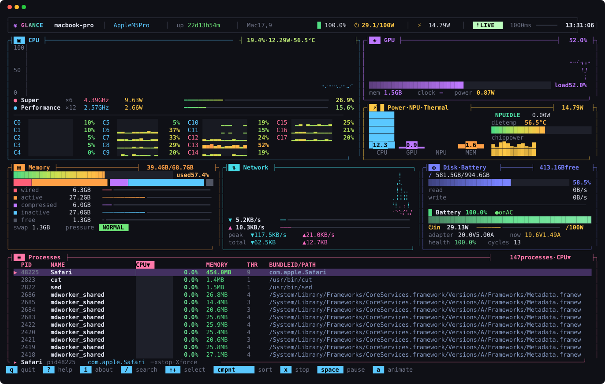
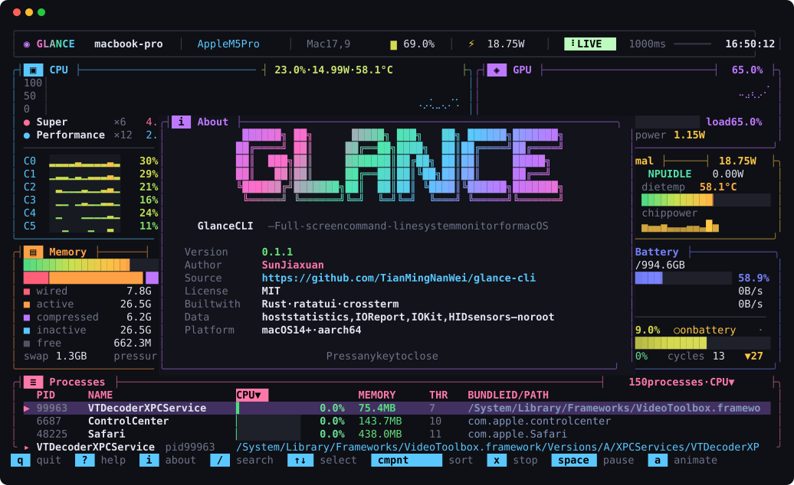

<div align="center">

# Glance CLI

**A btop-style system monitor for Apple silicon Macs.**

Every core, the GPU, the Neural Engine, power, temperature, memory, network, disk, battery, charger, and processes — on one animated screen, without root.

[](LICENSE)




</div>

## Contents

- [Features](#features)
- [Install](#install)
- [Usage](#usage)
- [Keys](#keys)
- [Where the numbers come from](#where-the-numbers-come-from)
- [JSON output](#json-output)
- [Development](#development)
- [About](#about)
- [License](#license)

## Features

**One screen, no paging.** The layout adapts from 100×30 up; at 160×48 or larger every chart gets its full height.

| Panel | What it shows |
| --- | --- |
| CPU | Load history chart, each cluster's frequency, power, and load, and every core with its own colored history |
| GPU | Load history, load bar, GPU memory, and power |
| Power · NPU · Thermal | CPU, GPU, Neural Engine, and memory watts as bars, Neural Engine state, die temperature, and chip power history |
| Memory | Used bar, a stacked breakdown, wired, active, compressed, inactive, and free, plus swap and pressure |
| Network | Download and upload chart, live rates against the session peak, and session totals |
| Disk · Battery | Disk usage, read and write history, battery level, health, cycles, and time left or to full |
| Charger | Input power against the adapter's rating (for example `⏻ 29.1/100 W`), negotiated and live voltage and current, and battery charge or discharge power |
| Processes | Every process you own with PID, name, CPU bar, memory, threads, and the full bundle ID or path |

**Lively bars.** Bars glide between samples instead of jumping, fill to an eighth of a cell, sweep with a shimmer, keep a peak marker that holds and then falls, and pulse near full scale. Panel borders throb when the CPU runs hot or memory pressure rises. While charging, energy flows along the battery bar.

**Process control.** Search by name, bundle ID, path, or PID. Sort by any column. Stop or force quit the selected process after a confirmation.

**Cheap to run.** About 6% of one core at 30 frames per second, or about 2% with animations off (`a`).

## Install

Requires macOS 14 or later on Apple silicon and Rust 1.85 or later ([rustup.rs](https://rustup.rs)).

```bash
cargo install --git https://github.com/TianMingNanWei/glance-cli
glance
```

Or build from a clone:

```bash
git clone https://github.com/TianMingNanWei/glance-cli.git
cd glance-cli
cargo build --release
./target/release/glance
```

Use a terminal with true color, such as Terminal, iTerm2, Ghostty, WezTerm, Kitty, or Alacritty. No Nerd Font is needed.

## Usage

```text
glance                   live view
glance snapshot          print one reading
glance snapshot --json   print one reading as JSON
glance about             author, version, license, and source
glance --version         print the version
glance --help            show usage
```

## Keys

| Key | Action |
| --- | --- |
| `?` `h` `F1` | Show every key |
| `i` | About Glance |
| `q` `Esc` `Ctrl-C` | Quit (`Esc` clears an active search first) |
| `↑` `↓` `j` `k`, `PgUp` `PgDn`, `g` `G`, mouse | Select a process |
| `/` | Search by name, bundle ID, path, or PID |
| `c` `m` `p` `n` `t` | Sort by CPU, memory, PID, name, or threads; press again to reverse |
| `r` | Reverse the order |
| `x` `Delete` / `X` | Stop (SIGTERM) / force quit (SIGKILL) the selected process, after confirming |
| `+` / `-` | Refresh faster / slower, from 250 ms to 5 s |
| `Space` | Pause or resume |
| `a` | Animations on or off |

## Where the numbers come from

Nothing needs root, `sudo`, or a helper.

| Reading | Source |
| --- | --- |
| CPU and per-core load | `host_processor_info` |
| Cluster frequency and residency | IOReport "CPU Complex Performance States", with clock tables from the `pmgr` device-tree node |
| CPU, GPU, Neural Engine, and memory power | IOReport "Energy Model" |
| GPU load and memory | `IOAccelerator` performance statistics |
| Die temperature | HID temperature sensors (`PMU tdie`) |
| Memory and swap | `host_statistics64`, `vm.swapusage`, memory pressure level |
| Disk | `statfs`, `IOBlockStorageDriver` statistics |
| Network | `getifaddrs` interface counters |
| Battery | IOPowerSources and `AppleSmartBattery` |
| Charger | `AppleSmartBattery` `AdapterDetails` and `PowerTelemetryData` |
| Processes | `proc_listallpids`, `proc_pidinfo`, `proc_pidpath`, app bundle `Info.plist` |

Limits:

- Fan speed is not shown; it would need SMC access.
- GPU frequency appears only when a device-tree clock table matches the GPU's performance states.
- Without root, macOS only reports processes you own.

## JSON output

`glance snapshot --json` prints one reading for scripts and dashboards. All fields use camelCase, and readings that are unavailable are `null`.

```json
{
  "host": { "chip": "Apple M5 Pro", "model": "Mac17,9", "osVersion": "26.5.1", "logicalCores": 18 },
  "cpu": {
    "utilization": 0.099,
    "powerWatts": 4.81,
    "temperatureC": 54.8,
    "clusters": [{ "name": "Super", "kind": "P", "coreCount": 6, "frequencyHz": 3542854816, "powerWatts": 4.43 }]
  },
  "gpu": { "utilization": 0.48, "memoryBytes": 1534656512, "powerWatts": 0.87 },
  "npu": { "supported": true, "powerWatts": 0.0, "active": false },
  "battery": {
    "fraction": 1.0,
    "cycles": 13,
    "externalPower": true,
    "batteryWatts": 0.0,
    "charger": { "ratedWatts": 100, "ratedVolts": 20.0, "ratedAmps": 5.0, "inputWatts": 29.1, "inputVolts": 19.6, "inputAmps": 1.49 }
  },
  "processes": [{ "pid": 48225, "name": "Safari", "identifier": "com.apple.Safari", "threads": 9, "cpu": 0.0, "memoryBytes": 476049408 }]
}
```

The output above is trimmed. The real output also includes per-core load, memory, disk, network, and power.

## Development

```bash
cargo test --release                # unit tests
cargo fmt && cargo build --release  # format and build
```

`render_preview` draws one real frame off screen, which helps when changing the layout:

```bash
GLANCE_COLS=160 GLANCE_ROWS=48 cargo test --release render_preview -- --ignored --nocapture
```

| Variable | Effect |
| --- | --- |
| `GLANCE_COLS`, `GLANCE_ROWS` | Frame size (default 160×48) |
| `GLANCE_MODE` | `help`, `about`, or `confirm` shows that pop-up |
| `GLANCE_SVG`, `GLANCE_HTML` | Also writes a colored SVG or HTML copy to this path |
| `GLANCE_DEMO` | Hides the host name and your home folder, and lists only system processes |

The screenshots in `docs/` come from:

```bash
GLANCE_DEMO=1 GLANCE_SVG=docs/screenshot.svg cargo test --release render_preview -- --ignored
GLANCE_DEMO=1 GLANCE_MODE=about GLANCE_COLS=120 GLANCE_ROWS=34 GLANCE_SVG=docs/about.svg cargo test --release render_preview -- --ignored
```

```text
src/
├── main.rs      commands and the live loop
├── tui.rs       layout, panels, bars, pop-ups, and input
├── anim.rs      frame clock, easing, and peak hold
├── about.rs     name, version, author, and banner
├── model.rs     the serializable snapshot
├── sample.rs    combines the samplers into one snapshot
├── sample/      cpu, gpu, memory, disk and battery, network, host, process
├── soc.rs       IOReport power and frequency, HID temperature
├── cf.rs        CoreFoundation and IOKit bindings
└── format.rs    units and number formatting
```

## About



Glance CLI is the terminal companion to the Glance menu bar and notch app for macOS. It reads the same unprivileged sources.

- **Author:** SunJiaxuan
- **Source:** [github.com/TianMingNanWei/glance-cli](https://github.com/TianMingNanWei/glance-cli)
- **Built with:** [Rust](https://www.rust-lang.org), [ratatui](https://ratatui.rs), and [crossterm](https://github.com/crossterm-rs/crossterm)

Issues and pull requests are welcome.

## License

[MIT](LICENSE) © 2026 SunJiaxuan
